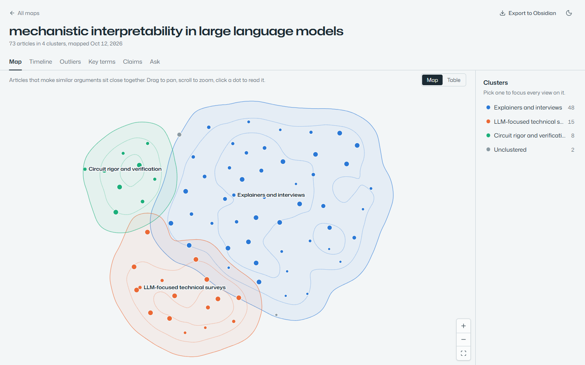
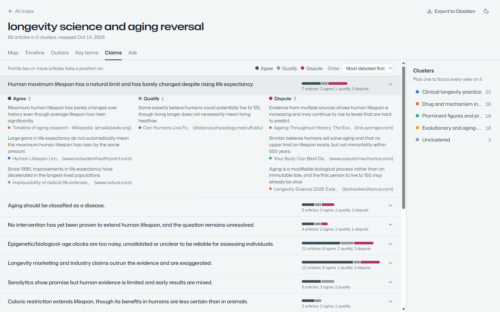
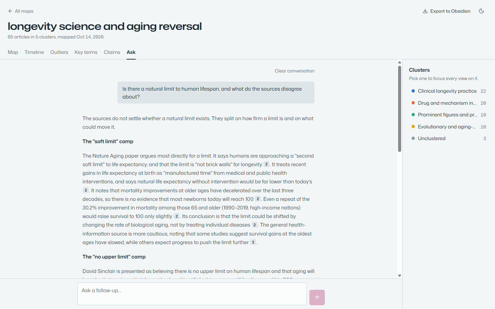
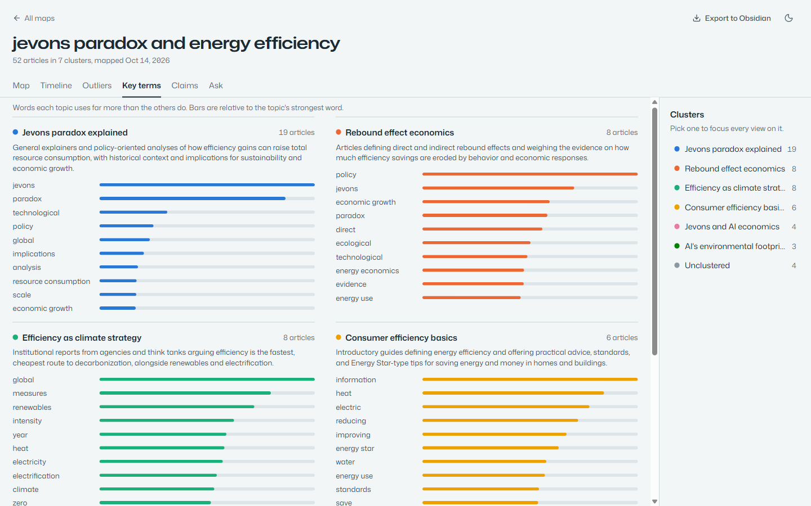
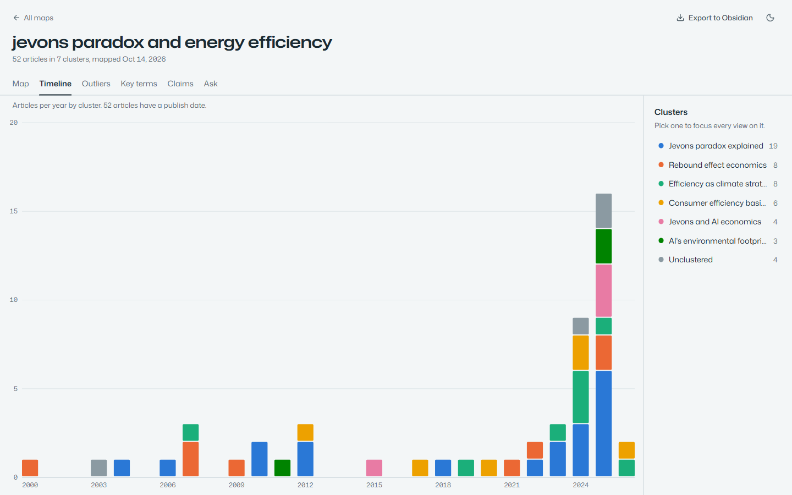
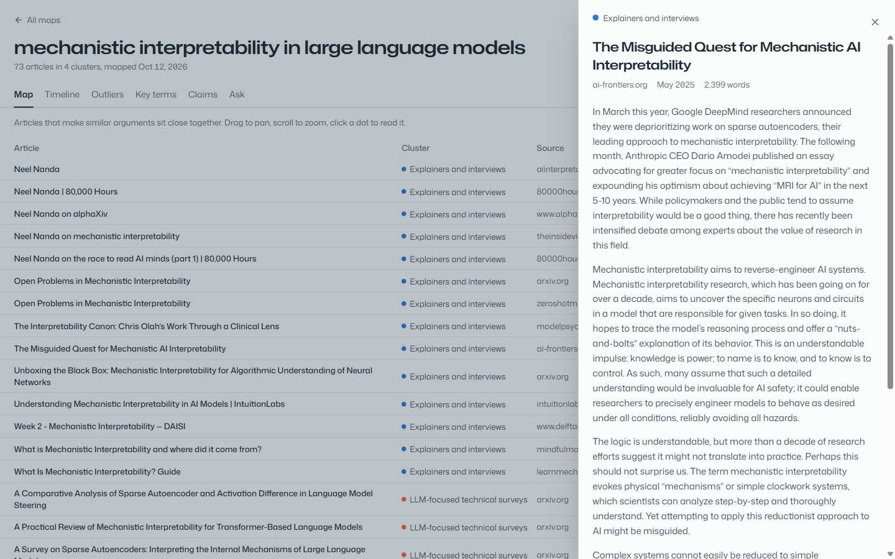
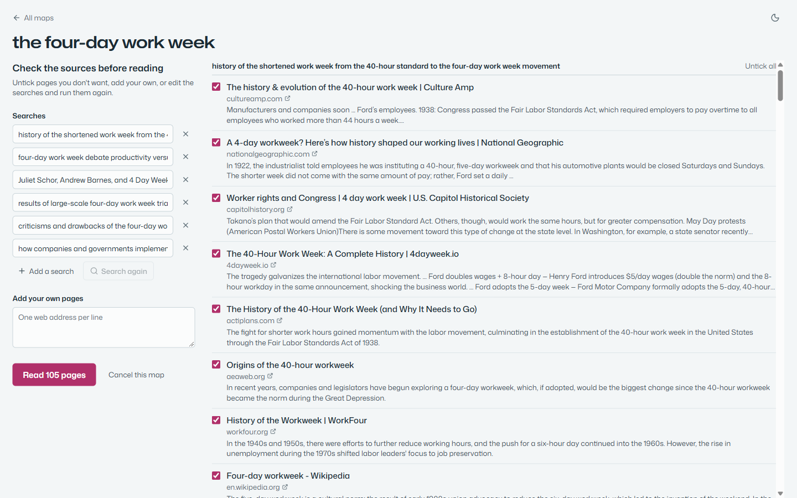
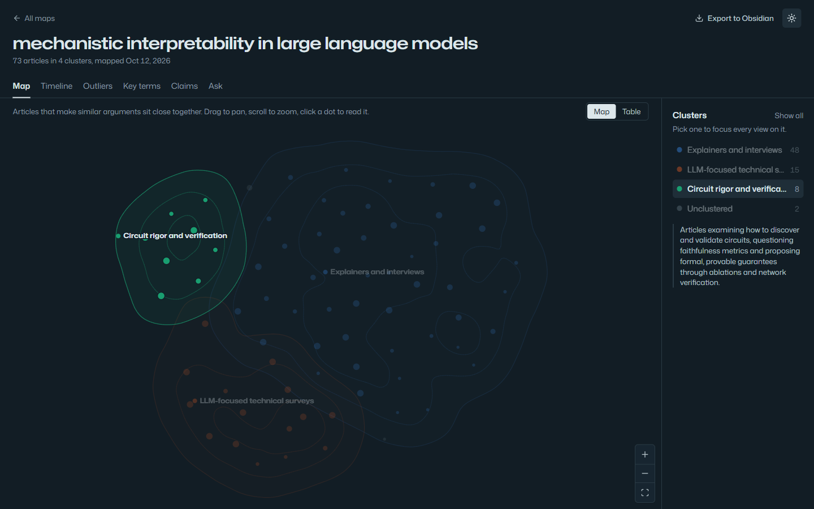

# discourse-lens

Discourse Lens takes a topic, reads around a hundred articles about it from the web, and maps the conversation: which camps exist, where the sources agree and disagree, how coverage has moved over time, and which articles don't fit. You can then ask questions answered only from those articles, with citations. Everything runs on your machine except web search and the Claude requests.



---

## What you get

Type a topic and Discourse Lens searches the web, reads the pages, and builds a map in 3 to 8 minutes. Every finished map has six views, plus a reader for any article.

| | |
|---|---|
|  | **Claims.** The points two or more articles take a position on, and whether each one agrees, qualifies or disputes them, most debated first. |
|  | **Ask.** Answers drawn only from the map's articles, streamed as they're written, with numbered citations you can click. |
|  | **Key terms.** Each topic's one-line summary and the words it uses far more than the others. |
|  | **Timeline.** Articles per month or year, by topic. |
|  | **Reader.** Any article's text in a side panel, from the map, the table or a citation. |
|  | **Source review (optional).** See the searches and pages before anything is read; edit, untick or add your own. |

The map works in light and dark themes, and picking a topic focuses every view on it:



---

## Requirements

- Python 3.12 and [uv](https://docs.astral.sh/uv/)
- Node.js 20.19+ (Vite 8)
- A [Brave Search API key](https://brave.com/search/api) (free tier: 2000 queries a month), or a self-hosted [SearXNG](https://docs.searxng.org) instance with the JSON format enabled
- An [Anthropic API key](https://console.anthropic.com), or Claude on Google Cloud Vertex AI

No GPU, Ollama or OpenAI key is needed: embeddings run inside the app.

---

## Setup

**1. Install the Python dependencies**

```bash
git clone https://github.com/Meerav29/discourse-lens.git
cd discourse-lens
uv sync                        # creates .venv from uv.lock
uv run playwright install chromium
```

Using Vertex AI for Claude? `uv sync --extra vertex` instead.

**2. Build the frontend**

```bash
cd frontend
npm install
npm run build
cd ..
```

**3. Add your keys**

```bash
cp .env.example .env
```

Open `.env` and set `BRAVE_API_KEY` and `ANTHROPIC_API_KEY`. Everything else has a working default; see [Settings](#settings).

---

## Running

```bash
uv run uvicorn backend.api.main:app --port 8001
```

Then open [http://localhost:8001](http://localhost:8001). The backend serves the app and the API from one address.

The first map downloads the embedding model once (about 520 MB, into `data/models`).

**No API keys yet?** Load a small made-up demo map to explore the interface:

```bash
uv run python -m scripts.seed_demo
```

---

## Using it

1. On the home page, type a topic and choose **Map this topic**. Tick **Let me check the sources before they're read** to see the searches and pages first.
2. While the map is built you see each step: the searches, pages read, articles kept or skipped (and why), and topics as they're named. You can leave the page or **Cancel this map**.
3. When it's done, switch between the views above. **Map** has a **Table** toggle for a plain list. **Outliers** lists the articles furthest from the middle of their topic.
4. Pick a topic in the **Clusters** panel to focus every view on it and read its summary. Articles that don't fit any topic well are grouped as **Unclustered** rather than forced into one. The address bar keeps the view, topic and open article, so links and reloads land in the same place.
5. **Claims** runs only when you choose **Find claims**, because it costs Claude requests: about half a cent per article (roughly $0.30 for a 50-article map), and it takes about a minute.
6. In **Ask**, follow-up questions build on earlier answers, and a citation number means the same article for the whole conversation. Conversations are saved with the map.
7. **Export to Obsidian** downloads a vault: a Canvas of the map plus one note per article.
8. Every map is kept. **All maps** returns to the list, where you can open or delete them.

### Good topics to start with

| Topic | Why it works well |
|---|---|
| `mechanistic interpretability in large language models` | Active research field with distinct camps |
| `longevity science and aging reversal` | Real disagreements for the Claims view |
| `urban heat islands and city design` | Recent policy debate, good timeline |
| `jevons paradox and energy efficiency` | Older topic with a long timeline |

Avoid topics that are too broad (`AI`, `climate change`) or too narrow (fewer than about 20 articles exist on the web).

---

## How it works

1. **Search.** Claude writes six search queries for the topic; Brave or SearXNG runs them (`backend/ingestion/search.py`). With source review on, the run pauses here.
2. **Read.** Playwright loads each page and trafilatura extracts the article (`backend/ingestion/crawler.py`, `extractor.py`). Academic publishers often block automated reading, so for those pages and for PDF links the app looks up open-access text or the abstract through OpenAlex, Crossref and Europe PMC (`backend/ingestion/scholarly.py`). The reader says where recovered text came from.
3. **Clean.** Articles under 200 words, non-English ones and near-duplicates are dropped (MinHash), and articles are split into chunks (`backend/processing/`).
4. **Embed.** Chunks are embedded with nomic-embed-text v1.5 via fastembed and stored in LanceDB, one table per map (`backend/embedding/`).
5. **Map.** BERTopic's recipe without PyTorch: each article's chunk vectors are averaged, reduced with UMAP, grouped with HDBSCAN, and described with c-TF-IDF key terms. One Claude request names and summarizes all topics so the names contrast (`backend/topics.py`, `backend/embedding/project.py`).
6. **Ask.** Hybrid search (vector similarity plus BM25 keywords, fused by reciprocal rank) finds the best excerpt per article, and Claude answers from those excerpts only (`backend/synthesis/chat.py`).
7. **Claims.** Claude lists each article's main claims from its opening, then groups claims from different articles into shared points with a stance for each (`backend/synthesis/claims.py`).

Data lives in `data/`: SQLite for articles, maps and conversations (`discourse.db`), LanceDB for vectors (`vectors/`).

---

## Settings

All settings go in `.env`; `.env.example` lists them with comments.

| Setting | Default | What it does |
|---|---|---|
| `SEARCH_PROVIDER` | `brave` | `brave` (needs `BRAVE_API_KEY`) or `searxng` (needs `SEARXNG_URL`) |
| `CLAUDE_BACKEND` | `anthropic` | `anthropic` (needs `ANTHROPIC_API_KEY`) or `vertex` (needs `GOOGLE_CLOUD_PROJECT`) |
| `CLAUDE_MODEL` | `claude-sonnet-5-5` | Model for queries, topic names, claims and answers |
| `EMBEDDING_MODE` | `fastembed` | `fastembed` (in the app), `ollama` (same model and vectors, served by [Ollama](https://ollama.com)) or `openai` |
| `MAX_ARTICLES` | `120` | Most pages read per map |
| `RECOVER_ACADEMIC` | `true` | Look up open-access copies of pages academic publishers block |
| `CHAT_EFFORT` | `medium` | How much Claude reasons before an Ask answer: `low`, `medium` or `high` |
| `RAG_TOP_K` | `15` | Excerpts searched per question |

Maps made with `EMBEDDING_MODE=openai` can only be searched with OpenAI, and the other way round; Ask tells you which setting a map needs.

---

## Development

Run the backend as above, plus the Vite dev server with hot reload (it forwards `/api` to port 8001):

```bash
cd frontend
npm run dev
```

and open [http://localhost:5173](http://localhost:5173). After changing the backend API, regenerate the typed client:

```bash
uv run python -m scripts.export_openapi
cd frontend && npm run gen:api
```

Checks (CI runs all of these on every push and pull request):

```bash
uv run ruff check backend tests scripts
uv run pytest
cd frontend && npm run check && npm run lint && npx vitest run
```

End-to-end tests drive the real app (backend and built frontend) against the demo map in a throwaway `.e2e/` folder, with no network or API keys:

```bash
cd frontend && npm run build && npx playwright install chromium && npm run test:e2e
```

---

## Troubleshooting

**A map fails or finds no pages while searching** — Check `BRAVE_API_KEY` (or `SEARXNG_URL` if you use SearXNG) in `.env`.

**Topic names look like lists of words ("Roof, albedo, paint")** — Naming the topics with Claude failed, so the app fell back to each topic's top key terms. Check `ANTHROPIC_API_KEY`.

**Embedding is slow** — Local embedding runs on the CPU: about 3 seconds per 10 chunks, so a few minutes for a typical map. `EMBEDDING_MODE=openai` is faster, for new maps only (see [Settings](#settings)).

**Answers are slow to start or too brief** — Set `CHAT_EFFORT` to `low` or `high`. In testing, `medium` started answering in about a second, the same as `low`.

**Ask says "This analysis has no indexed corpus yet"** — The map hasn't finished, or no articles passed the quality filter. Try a different topic.

**Don't want the open-access lookups?** Set `RECOVER_ACADEMIC=false`; pages a publisher blocks are then skipped.

**Upgrading from an older version** — On first start the backend migrates the database. Maps made before topic modelling keep their old clusters, without key terms or summaries, until you rebuild them from the stored vectors (no re-crawl; one Claude request per map):

```bash
uv run python -m scripts.recluster --all
```

The very first migration (from the single-corpus version) copies `data/discourse.db` and `data/vectors/` to `*.v1.bak`; delete those once you're happy.
